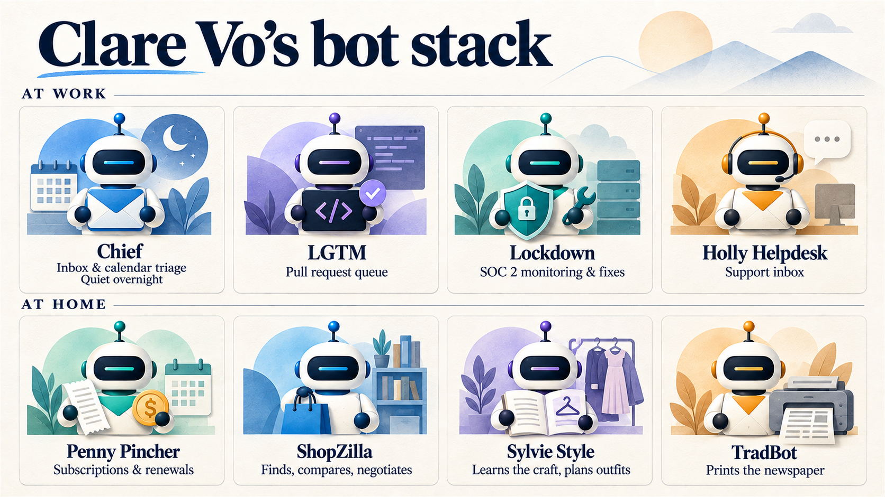

# Nine Bots and One Computer

**Status: DRAFT rv7 -- rv6 IS HIS EDIT PASS and it filled the hole: the whole "what I built" account is his, dictated. rv7 is the edit and cleanup HE ASKED FOR (12 Sep, 00:30, before sleeping): **his 5,156-word section is now 3,609**, cut for repetition and dictation wreckage, NOT for content -- every bot, every timing, every number and every judgement of his survives. **It was one undifferentiated block and is now SEVEN sections**, which is the single biggest readability fix and is why the length stops being a problem. The Lifeguard beat is restored per his word ("a concurrence error, I didn't strike it intentionally"). His map is placed where his comment marked it. Mechanics: Grokbot -> Grok Bot throughout (matches the SpaceXAI ruling), Clare -> Claire, one em-dash, dictation errors ("Zendesk patterns box" -> bot, "that you meant bot" -> minted). **Total body 7,653 words, down from 9,112.** Em-dash-free; US spelling. NO OPEN [VERIFY].
**Series: Weekday feed (Saturday Diversion) · Thread: Diversions · Part 1 of 2 with Sat 19**
**Source: References\week-plan_2026-09-07.md status board v2.8 · research_grokbot-buy-build_2026-09-10.md**

**⚠️ THE HOLE: `## [HIS SECTION -- INTERVIEW]` sits after the correct-forward. It is the "here is what I actually did with it and what it cost me" beat, and it is the reason this is part one of a buy-and-build pair rather than a product review. Do not fill it from research. It is his.**

**★★ TWO REQUIRED CALL-OUTS, both present:** (1) the correct-forward on `Teaching Is Exfiltration`, 2 Sep, under `## What I got wrong on the second`; (2) the OpenBot name collision and the memecoin, under `## Nobody owns the name "OpenBot"`.

**⚠️ WINDOW -- and one collision forced a redesign.** Tue 8's published close (*"the control that is right there in the documentation, working exactly as described"*) and Fri 11's draft close (*"Somebody told you, in writing, on the vendor's own website... It is just easier not to"*) are the SAME MOVE: the vendor documented it and nobody read it. **Two uses in seven days. A third on Saturday would be a categorical fail.** So the shared-computer fact is written as **a spec a buyer needs**, not as a revelation. No "and they told you all along" anywhere in this piece. Also avoided: sat-nav / one honest rep / minefield (Sat 5), load-bearing wall (Sun 6), forwarding address and all routing imagery (Mon 7), loyalty points / earn rate / the meter (Wed 9), pharmacy / gate / front door / shelf / eligibility (Thu 10), the glass (Fri 11).
**Controlling image: the kitchen table newspaper. It is not a metaphor, it is a real thing somebody prints, which is why it cannot bleed.**
**Tier 0 bookend: one clause, early, naming Sat 5 and the tension with it deliberately rather than dodging it.**
**⚠️ HEADERS REWRITTEN AT THE MECHANICAL PASS. v1 drafted SIX comma-and-clause headers, which is the exact form the window is scorched on -- Mon 7 had to rename two for it, and its board records the window as heavy with them. The set now runs four noun phrases, two declaratives, one imperative and one wh-phrase, with ZERO comma-and-clause. Also re-checked against the other scorched pattern, "What X actually Y" (four backward plus Wed 9): v1 had two, now none.**

**✅ DISCLOSURE REVIEW CLEARED, 12 Sep. He replaced the live screenshot with a redrawn generic grid and all three findings are resolved.** Employer name gone from the title. **Bryan and Jason gone.** Every vendor genericized: Zendesk SLA/Triage/Patterns/Customer Report are now Ticket Triage, Issue Patterns and Customer Reports; Jira Focus is Project Focus; Bitbucket and GitHub PR Radar are Code Review; Dependabot and CodeRabbit are Fix Tracking; YC Podcast Notes is Podcast Notes; last30days is Topic Research. **The surrounding app chrome that was visible at the edges of the original -- a message list with timestamps and a "Message Chief of Staff" input box -- is also gone.** Checked and clean: no EXIF, no tEXt/iTXt/zTXt chunks, no prompt string, no URLs, no account identifiers.

**⚠️ BUT THE IMAGE CARRIES C2PA CONTENT CREDENTIALS AND THE TEXT NOW MIS-DESCRIBES IT.** The PNG has a 23,617-byte `caBX` chunk holding a signed content credential: `dname: gpt-image`, `version 2.0`, `digitalSourceType: trainedAlgorithmicMedia`, signed by **OpenAI Media Service API** with a full OpenAI certificate chain. **That is not a leak and the credential should NOT be stripped** -- he writes about provenance and removing one would be indefensible. **The problem is the sentence.** The draft still reads *"I give you a screenshot of my current subset below"* and this is an AI-generated illustration that is **cryptographically labelled as one**. A reader who drops it into a C2PA verifier gets "trainedAlgorithmicMedia" against text that says "screenshot." ⛔ **His call, and it needs making before this ships. Two options, neither applied:** change "screenshot" to something accurate (*"a redrawn map of my current fleet, names genericized"*), or keep it and say plainly that it is a drawn stand-in for the real thing because the real one names his employer and his colleagues -- **which is arguably a better paragraph, since the reason for the redraw IS the piece's argument.**

**✅ ALL FIVE ITEMS RULED AND CLOSED BY HIM, 12 Sep. Recorded so the panel does not re-open any of them.**
**1. The $200 launch price and the load reading.** *"I know that it was that price because I went and looked at it myself, so we don't need to foot it any further."* **Author-verified. It stands. ⛔ The skeptic seat must not flag it.**
**2. SpaceXAI.** *"That's just a typo or a dictation... Render it the way that you have it."* ✅ **APPLIED** in this revision.
**3. The security-logs line.** ⚠️ **I READ IT WRONG and the line was never the problem.** He is not saying the shared computer was hard to find. He is saying the logs are where you can **see the shared context becoming a problem in practice** -- *"there's other stuff that's in those logs. It's important, like drift and a bunch of other shit as well, but we're talking about security at that point."* **Unchanged, and correct as written.** ★ The drift material in those logs is a separate piece and is worth benching.
**4. "The self-improving nature of the swarm."** ⚠️ **It is NOT a product claim and I mis-scoped it.** His words: *"it has nothing to do with Grok Bot. It's just like when I work with you, just like when I work with any other AI: the self-improving nature is you set things up, you ask yourself questions, you pursue things, and you make it better every step of the way. That is about setup. That is not about capability. It is setup 100%."* **The sentence already carries "if you set it up right," so it stands. ONE SMALL SHARPENING PROPOSED, NOT MADE** -- see below.
**5. "It took a weekend and change."** *"It's accurate enough."* ✅ **Closed. It stays.**

**PROPOSED, NOT MADE, on item 4.** A reader without his explanation can still take "the self-improving nature of the swarm" as something the product does. The setup-not-capability distinction is the more interesting claim and it is currently doing its work in a subordinate clause. Something like: *"Add to which the fact that a setup like this improves itself if you keep asking it the right questions -- which is a property of how you work with any of these tools, not of this one..."* His call entirely; the current sentence is not wrong.

**✅ SOURCES, all fetched live 10 Sep 2026. Full detail and a 9-item DO-NOT-PRINT list in `research_grokbot-buy-build_2026-09-10.md`.**

---

Somewhere in San Francisco a printer turns on early and prints a one-page newspaper. It has the family's day schedule on it, the weather with a line about what to wear, a note about a spelling test, and a couple of news stories chosen to be interesting to a nine-year-old, a twelve-year-old, and concise enough to be scanned by mom before breakfast is on the table.

Nobody wrote it. It cost about twenty dollars a month, bundled into a subscription its owner was already paying for, and it lands in the printer out tray before anybody comes downstairs and on the kitchen table sixty seconds later.

Last Saturday I wrote about protecting the thing you can still do when the tool is switched off. This Saturday is the other side of that argument, and I am not going to pretend the two sit comfortably together: this is a piece about handing more of your week to software. Both are true. You can decide which parts you are willing to stop doing, but only if you know what is actually on offer, and what is on offer changed this year. Honestly, what's on offer, for most of us, changed *last month.*

## Named agents with a computer

Grok Bot is xAI's product, and the pitch is simple enough to state in a sentence: you create named agents, they get a computer to share amongst themselves which you don't have to rent separately, and they go and finish work in your real tools instead of handing you a draft -- as far in as you are willing to let them, or as restrained as you determine them to be.

The docs are unusually plain about it. A Bot is *"a single persistent, named agent or one AI teammate."* And:

*"It has a computer of its own. Each Bot runs on a persistent cloud VM with a browser, filesystem, and terminal. It can use connectors/MCP where available, and computer use for apps and websites without a clean API, so work finishes in the real tools rather than as chat drafts."*

I want to be clear on that paragraph before I get into the rest here -- the marketing makes it sound like each bot has its own computer; it doesn't, which you can tell if you get down and dirty with the security logs. Your *account* shares a single virtual computer, and the bots work within that space. That's important to keep in mind, because there is no implied security boundary here besides good behaviour -- so one bot's access could easily be ALL bots' access if the guardrails are deemed to no longer be appropriate [and by "deemed", I mean not by you].

Three things make it up. **Bots** are the agents, and the naming matters more than you would expect, because the platform infers the job from the name. **Plugins** are the connectors: Gmail, Calendar, Drive, Slack, Notion, GitHub, Sentry, Stripe, Outlook, Office, BitBucket, you name it. **Routines** are schedules, so a bot can run at 6:30 every morning or at 2:30 every afternoon without being asked. Or every 15 minutes (congratulations! you're running an agent) but be careful with those, you can run out of subscription fast when you are recurring that frequently.

The feature that seemed -- at least in the first couple of weeks -- to convert people is unglamorous but something those of us with complex lives and AI associates have been trying to construct reasonably for years: multiple accounts per connector. If you have four email addresses and seven Slack workspaces across a couple of businesses and a household, one agent layer can see all of them. That is the whole unlock for anybody whose life does not fit inside one tenant. Add to which the self-improving nature of the swarm, if you set it up right, and not only do you have a big unlock to entry, but it easily grows with you and your comfort level without going from simple to seriously painful in a single step, as many pieces of software tend to do.

## Twenty dollars a month

There is no Grok Bot subscription. But, there is a subscription. In xAI's own words:

*"Do I need a separate Grok Bot subscription? No. Access is included with Cursor Pro, Cursor Pro+, Cursor Ultra, or a Cursor Teams seat, or through an individual SuperGrok, SuperGrok Plus, SuperGrok Heavy, or X Premium+ account link."*

The entry price on xAI's own Grok Bot page is **twenty dollars a month** on Cursor Pro, or thirty on SuperGrok. Cursor's pricing page lists "Grok Bot access" against the twenty dollar tier. SpaceXAI started it out at ten times that price, though it is now clear that was just to manage load. A lot of the early writings and podcasts were "is it really worth $200/month?" whereas most of them now are about "this is the price of a few coffees, for something super approachable, can you really afford *not* to have it?" It is a clear and important transition, but it is not the whole basket.

I want to be specific about this because the numbers in circulation are a mess. If you already have a Grok relationship of some meaningful type (i.e., a subscription), you probably get it included. If you already have a Cursor plan, same thing. If you have neither, as I am always telling you, start at the $20 level (the lowest you can start) and see how you go. You can always increase it later if you are finding the value and the return there.

And if you are really nervous about it, they have a free trial -- 7 days or the use of all the provided tokens, whichever comes first.

## Only four of the nine are for work

The most useful thing, so far, for me, published about this is not from xAI. Claire Vo, who founded ChatPRD, has been around the traps for years, is part of the Lenny's Podcast family of serious AI users and presenters, and hosts the *How I AI* podcast, put out an episode on the second of September walking through the agents she runs, with a written companion post so you do not have to squint at a transcript. She says she runs about thirty at any given time. She demonstrates nine. 

*Four at work, four at home, one control plane.*

Four are what you would expect. **Chief** is a chief of staff that sweeps six inboxes, several Slacks and several calendars every hour from six in the morning to nine at night, archives what does not matter, and pings her only on things that do. She deliberately set it so it switches it off overnight, and her reason is a better piece of management thinking than most management books: *"I don't want people to get used to me responding to them overnight."* Now, without peeling apart the management strategy there, I think the key point is this: it takes what you want and makes it so. It has a generalized model, but it will follow your instructions down the line. No messages on Sunday? Tell it. It skips the day. Only messages from family members or key commitments on Sunday? It can do that too. It is as good with edge cases as it is with use cases.

**LGTM** works her pull request queue [a developer and development management issue, but which has a corollary in just about every piece of knowledge work there is] and helped her clear about fifty in a single Friday afternoon before the weekend. **Lockdown** watches her company's SOC 2 controls, and when a vulnerability appears it triages it, opens a pull request with a fix, and assigns it to her so she is always on top of her compliance. **Holly Helpdesk** works Intercom and the support inbox hourly.

The other five are somebody's life. **Penny Pincher** went through her receipts looking for subscriptions to cancel, found a long-dead Apple Arcade account from when the kids were small, and then did something nobody asked it to: it noticed home insurance renewing in a couple of months and proposed shopping the market before the renewal. **ShopZilla** found a bookcase that fits an awkward corner, and then found a birth-year Rolex, researched fair market price, worked out which listings were open to negotiation, and started negotiating. She did not buy it -- but she could have. **Sylvie Style** built a wardrobe plan, and the clever move there is worth stealing: before it did anything, she told it to *"go look on Reddit for personal stylists and how they approach building people's wardrobes."* She made the agent go and learn the craft from practitioners before applying it to her. She took a generalized thing that was plucked from the Commons on the Internet and made it very specific to what works for her. And she did it with a simple set of instructions and a pat on the virtual head.

And **TradBot** prints the newspaper.

The ninth is not in the picture, because it does not exist any more. She kept one bot in her old system whose only job was managing the others, used it to export what she calls a secrets-free package of every agent, schedule and rule she had, dropped the folders into Grok Bot, and then told it to shut the last one down. She calls the move a brain transplant.

That is the one at the top of this piece. A one-page digest every morning with the day's schedule, the weather and what to wear, per-child updates pulled out of school emails, and a couple of kid-appropriate news stories for breakfast. A separate routine at 2:30 each afternoon that messages her and her husband to settle who is doing pickup and what gear is needed, because three kids in three sports across one city generates more logistics than any two adults can hold in their heads, especially on busy weeks. Anyone who has ever mishandled a school pickup and had the sinking feeling when the auto-dialer rings your mobile knows how valuable that can be. For a bit of lightness for everyone, and for planning what time everyone needs to go to bed Friday and be up Saturday morning, a Friday routine automatically previews the weekend in appropriate detail.

Her husband's contribution is one of my favorite details in the whole story. He emails the PDF to a Kindle so it arrives on e-ink instead of a screen. And I will probably come back to this, if not in the piece then in future Saturday diversions -- one of the most powerful pieces of these kinds of tools, at least for me, is the fact that you can make virtually any connected device a control surface. That, again, all by itself, can be game changing, depending on how many devices and tools and everything else you use, odds of which the last thing you need is one more.

Which points at the design principle underneath all of it, and it is the opposite of how most software is built:

*"My goal for a household agent is simple: it should get me off my computer and spending more time with my family."*

That is why the thing prints on paper. The output surface is deliberately not a phone (it is, however, another control surface for you to leverage, for good or ill). If this is something you struggle with -- getting up and walking away, and most of us, especially those who are AI-pilled in a serious way, fight this battle constantly because the gravity just keeps getting stronger -- then any tool which enables that quickly, without massive effort, and does it in a way that doesn't force you back to the laptop, or trade the phone for a regular interaction, or any of the other million distraction machine items it could be -- is worth its weight in gold.

## Read this before you connect anything

Here is the specification that decides how you should use this, and it is worth understanding before you plug in your first account rather than after.

You do not get a computer per bot. You get one computer, and every bot you create shares it.

*"All of your Bots use the same persistent cloud computer. They share files, browser sessions, and app logins... Each Bot gets its own screen on that computer, so several Bots can use browser and desktop tools in parallel without getting separate security boundaries."*

And more bluntly: *"Do not use separate Bots as a security boundary."*

So browser cookies are shared. Signed-in sessions are shared. Files are visible to every bot you run. Command-line credentials are shared. Deleting a bot does not remove what it left behind. The isolation is real, but it is drawn around **you**, not around each agent: every user gets their own hardware-isolated virtual machine, and xAI's advice when a job genuinely needs its own credentials is to give it its own user account entirely.

Take that as a design instruction rather than a warning. It means the sensible unit is not "a bot for each thing" but "a computer for each trust level." If a bot is going to hold a login you would not hand to a contractor, that is a decision about the whole account, not about that one bot.

There is a second thing worth knowing at purchase time. The tokens for your connectors never touch that computer, which is genuinely well built: *"Bots invoke tools without receiving OAuth tokens, and tokens are never stored on the computer."* A bot also cannot exceed your own access: *"A Bot can never hold more access than the person it belongs to."* What is shared is what a human types into a terminal or leaves in a working folder.

And one that will matter to anybody buying this for a team rather than for themselves: most of the administrative controls are Enterprise-only, and Enterprise is currently waitlisted. A self-serve team gets no audit log, no network controls, no organization-wide off switch, and, in xAI's words, *"A separate Grok Bot spend cap is not available today."*

## A bot that knows your children's names

There is a public catalog of bot templates. Sixty-nine of them, from forty-three creators, across nine categories. You browse, you click Add, and the configuration lands in your account.

TradBot is one of them. Claire Vo published it, so the newspaper is not a bespoke thing you would have to build yourself. It is one click.

That is the part I want to slow down on, because it is where the convenience and the specification meet.

The listing carries xAI's own disclaimer: *"This AI bot was created by a third-party user, not by SpaceXAI. It may act on your behalf."* The default connectors it asks for are your personal Gmail and Google Calendar. And its first-run setup collects, in the template's own published wording: your timezone, your name, your spouse or partner, other caretakers, your kids with their first names and ages and grades, their schools and teachers, their activities by day, who does pickup and at what time, your city, and your recurring bills.

None of that is hidden and none of it is sinister. It is exactly the information the job requires. A bot that catches a pickup clash has to know who does pickup.

But it is worth holding those three facts next to each other for a second before you click Add, because they arrive in a different order than you would choose. A third-party configuration the vendor explicitly does not vouch for, importing in one click, asking for the mailbox that has everything in it, onto a computer where every other bot you run can see what it leaves behind. Any one of those is fine. The combination is a decision, and the interface does not present it as one.

There is a tell in the catalog, incidentally, that suggests the creators know exactly where the anxiety sits. Read enough listings and the same reassurance keeps appearing in slightly different words: *never sends without you. Never posts on your behalf. Never buys unless asked. Nothing publishes without you.* Forty-three different people reaching independently for the same sentence.

## What I got wrong on the second

On the second of September I wrote a piece about teaching agents by recording yourself, and it rested on an absence. My claim was that xAI documents what its recording captures and says nothing about how long it is kept, whether it trains on it, or who can control it.

That was true when I wrote it. It is now only partly true, and since I am back on the same product, this is the place to fix it.

Two of the three gaps have been answered, just not on the page I was reading. xAI's security documentation now states that with Privacy Mode enabled, customer data is not used for training, and gives its Action Recording feature a ninety-day retention. The administrative question is answered too, and the answer is less comfortable than silence was: there is now a published table of controls, and most of the meaningful ones are Enterprise-only.

The third gap is still open, and it is narrower and better than what I originally wrote. Teaching a task by demonstration is still documented in exactly one sentence: *"Teaching records visible computer interaction for up to ten minutes. It does not record microphone audio. Avoid exposing secrets during the demonstration."* That is the whole disclosure. No retention period. No training statement. No administrative control. The ninety days belongs to a different mechanism.

So the honest version of my September claim is one mechanism rather than a product, and I would rather print that than let the original stand as though it were still fully true.

## Why I waited

I came to this myself after listening to Claire talk about it, and I was hesitant at the initial strike price. I already spend a fair bit on inference every month as it is, and I do not feel the Grok models are strong enough to outweigh the coding I get from Astra, Opus and DeepSeek. So I held off for a few weeks until the price came down. When it got to a point consistent with what I was already paying for my Cursor license, I figured I might as well go for it.

Then I started building bots, and Grok Bot makes this ridiculously easy.

The first thing they tell you to do, and everything tells you to do this, is to make your chief of staff bot. As you saw in Claire's list above, she named hers Chief. I just left mine Chief of Staff, because I am an engineer and I do not give things cutesy names, which I probably should practice at. I minted it, and then I talked with it for a while about my job and what I actually do.

There are some basic setup questions to get you going. What is your intention here. What do you do for a living. Do you work in marketing or sales or engineering or product. Grok Bot does a fair bit of this setup for you so you can mint the core bot, and that core bot ends up becoming your communication path to all the other bots. You can talk to the others directly, and I did for a while because I am conceptually more comfortable that way. As I got more comfortable with how they looked and what they had to say and where they were sitting, I left more and more in the hands of the Chief of Staff.

The pattern they want you to end up with is the Chief of Staff at the center, because it makes everything else easier to manage. Build that pattern first, and then when you start doing things that need a whole group of bots, you shift to using the Chief of Staff to manage the head of that group, which in turn manages the group.

**And here is the thing that makes it approachable, which is also the thing AI is doing so much better now than it used to.** If you give it guidance in a comfortable, convenient way, and you tell it to confirm that guidance with you before it does anything else, it will go away, take what you said, turn it into what it thinks are instructions, and come back and ask: is this what you told me to do? Is this what you want me to do? You approve it, and off it goes.

It is often better at telling itself what you want it to do than you are at telling it what you want it to do. It is often better at taking what you have said and turning it into an instruction set, particularly when what you are instructing is other bots.

The second bot I installed does not appear in my map below. It is called Dr. Eggbot, built by a fairly well known X poster who actually works at SpaceXAI, and its whole job is making sure the bot you mint actually aligns to what you asked it to do. It is the same idea one level up: you say this is what I want to accomplish and this is roughly how, and Dr. Eggbot turns that into something that actually does it, with the same feedback and confirmation loop.

The third was a bot searcher. It looks around for other bots, sees whether anything new in the public catalog might be worthwhile, and once a day comes back with no more than three suggestions. The fourth came out of that: a last-thirty-days bot, whose job is research across Reddit and Instagram and TikTok and Substack and everywhere else on topics you hand it. I installed it and said, tell me about Grok Bot versus Astra. It went and did the work and came back with a spread of perspectives. I do a lot of research and I am familiar with research agents. **This is the easiest one I have ever had to stand up.**

So at that point I have three bots doing different kinds of work, and I have spent maybe ten or fifteen minutes. No crazy investment. No massive setup. Some of that was expedited by already having a Cursor account. If you do not have one, you create either a Grok or a Cursor account, attach a means of payment, and pick a subscription, or start on the free trial.

## What broke first

Fifteen minutes in, I decided I had learned everything there was to learn about minting bots and moved on to operations.

The first one was a Zendesk patterns bot, which sits under Support in the map below. Its job is to see patterns across our ticket corpus: problems shared across a bunch of different sites that are not individually important enough to bubble up, but in aggregate are evidence of something bigger. That is very consistent with what I have argued about patching over the last couple of months. It is the same concept, and it is hard for the people in the trenches to see, because they are so busy solving the problems that they do not lift their heads up to look across the trenches for the pattern.

Fifteen or twenty minutes to define, a couple of prompt iterations, and then the computer-use process, which Grok Bot makes very natural. It logged into my helpdesk, let me go through the sign-in myself, and held the credentials so it could run those same searches as me afterwards. The login itself took about five minutes. Most of the time went on the prompt.

**And this is where it went sideways, which is what usually happens when you decide you understand something well enough and go off and poke at it.**

The methodology worked fine on a limited basis. Then I made the bot recurrent, and then I added a couple more bots searching against the same backbone, and **I started getting session locks.** Zendesk looked at the traffic and concluded, reasonably, that I was logging in from too many places at once. I ended up associating an API key with Zendesk for that use case, and the only reason I had to was that my time intervals were aggressive enough that ordinary login kicked it back.

That was the first real surprise. Four bots in, I was maybe forty-five minutes down, and that is being conservative. The problem did not surface until a couple of hours later, and the fix was a more robust security conversation with Zendesk than I had planned on having.

It was bots five and six that caused it. Five is the triage bot, which watches new tickets, raises anything heading for an SLA breach, and drives a public response back to the customer so the ticket does not disappear into the ether. It gets a fair bit of work overnight when the desk is closed. It only responds to human-generated tickets: a system-generated ticket in a repetitive process does not trigger another response, and there is a fair bit in there for deduplication and context management so it does not go wild.

When I started it, I said start from here. Then as cases came through that I did not want, I tuned it. Do not do this. Only look at these types of things. Only give me a response on that. Only come back to me at this point.

## The enthusiastic intern

**It helps to think about these bots as a very enthusiastic young intern who brings you everything you asked for, every minute of every day, without hesitation.** Until you give them the capacity for discernment, the ability to decide what matters to you and what does not, they will just keep coming, and keep coming, and keep coming.

You heard me mention this higher up, where Claire has her bots take a break overnight so she does not wake up to three hundred items at 8:01, or get a phone call at 5:01 because something one of them found looked concerning. From a mental-health perspective and from a plain management perspective, that is a genuinely important directive.

**Make sure your bots know when to leave you alone.** They are not people. They have none of the cultural tics that stop a human from calling you at eleven at night, so they will never leave you alone unless you tell them to. If you have not worked with agents before, and I am assuming most of you have not, that is probably the single most important thing to take out of this.

## The rest of the fleet

The third helpdesk bot is customer reports. I identify customers I know are having issues, either from my own read, or from my partner, or from field staff feedback: the vibe is not quite right, or satisfaction ratings are off. That bot pulls a report every day at ten in the morning as an Excel file, one tab per customer. You flagged these eight as problematic. Six of them have nothing. Two of them have problems. It lets me point the team at what is actually there.

It is more pattern than detail, and that is one of the places agents are genuinely good: taking a crap ton of detail and turning it into a pattern that is meaningful and navigable.

Those were my first six. Three were standard defaults and three addressed support.

The engineering ones are mostly self-explanatory, but one is worth calling out because it matters to where I end up at the bottom of this. Fix tracking sits inside code review, and I have a pair of bots there, a PR PM and a PR Dev. They watch pull requests as they come in. A third bot from Antagonistic AI is looking at the same PRs trying to find problems, and when it finds them, my pair fix them overnight. By the time I sit down to review in the morning, which I do a fair bit of, the PR is as close to done as it can get without me in the middle of it and without sending it back to the developer. **That pair alone saves me ninety minutes to two hours a day.**

The inbox bots are straightforward, and the single biggest unlock out of the box is the one I mentioned above: I work from three Outlook accounts and three Gmail accounts every single day. It ended up being a family of bots, and I would encourage you to think of it that way, as a family rather than a list. They work through all of that email, triage it, identify what I need to answer, surface things I would have missed, set follow-ups and then remind me about them, and let me nominate customers for a key watch list so that anything from those accounts reaches me straight away instead of waiting for my next pass through the inbox.

The point of that family is that it lets me be more responsive to other people on the things that actually matter.

*One job per bot. Five groups, names genericized.*

## Two I am proud of

In the first column there is the Chief of Staff, and then two I want to spend a minute on. I do not know whether anybody else has the same management problems I do. These may only make sense to me, and that is fine. As long as it makes you *think* about where you might get something similar out of your own use cases, it has done its job.

A few months ago I built something I call the Promise Tracker. It was tied into my meetings, my transcript notes and my email, and it looked for places where I had promised somebody I would do something, so that I would not drop it. Some of that is a pattern of behavior on my part. Some of it is just the nature of a scaling business. **Over the past four months or so I have tracked upwards of five hundred promises through it, and delivered them. It is not a place where promises go to die. It is something I actually use.**

The Promise bot is the next iteration. It watches the conversations between me, my two business partners and the senior managers, takes any commitment made by any of us to any of the others, and keeps the ledger. We have a founders meeting on Monday mornings, and thirty minutes beforehand it generates a report and sends it to the three of us: everything we owe each other, so we can talk intelligently about where those things stand.

The same bot works for standups with my senior development managers and my senior product manager. Similar bots sit on customer-facing calls, so that if we have committed to a customer that we will do something, and that something touches my area even though I was not on the call, it is on the books and being prepared for rather than scrambled at the last minute.

It is useful for keeping track, and it is more useful for protecting against surprises. The effect is that I look far more responsive and far more involved in specific subtasks than I could otherwise be, and it gets there by keeping those things in second or third position rather than letting them fall to seventh.

**And the reason it is bidirectional is the part I would steal if I were you.** It tells everybody who works with me what I am going to want to discuss before we sit down. They are prepared. Nobody sits in a meeting while I ask about X and looks at me like I have started speaking another language because I have caught them completely off guard. It just makes the human side of the business run better.

The last one is new and I am quite excited about it. It is a recognition bot, and where the Promise bot watches what we committed to, this one watches what we delivered, and in particular it watches for a customer coming back to say: I really appreciate you doing that in that time frame, that was fantastic.

In a scaling business, and I have been in more of them than I care to count most days, that kind of individual recognition gets lost. **The trick is that it cannot recognize everything**, or the recognition stops meaning anything. So it surfaces candidates. It will draft an email sometimes, but usually I write the email myself, because if I am going to recognize you then I should be the one recognizing you. The bot does the searching and the aggregating, and then I apply my taste and decide what is actually worth it.

I have had it for a couple of days and it has already found several places where somebody needed a pat on the back and was not getting one.

## Your map will not look like mine

That raises the first of two things I want you to take away.

**My bot map and your bot map are going to be completely different.** I am happy to share anything I have built, happy to talk about bots, happy to sit down and help you work out what you could use and mint them. But the odds that we end up with the same map are very small, and it is worth knowing that walking in. Everything here is maps and signposts and possibilities. None of it should define what you do. Your own use cases should do that.

You are not taking twenty things off a shelf and hoping that is good enough. You are building things that align with how you actually work, and with what you need, and, if you remember Claire's line at the top of this piece, with getting you out of the house and up a mountain or into the ocean or wherever it is you would rather be than managing your business and your personal admin. **The point is not for the bots to become all-consuming.** The point is for them to put your energy back into the things you never get to and wish you did.

That is the promise a lot of the top people in AI have been making about what this should do for you. I am a genuine believer that it is what we should be building towards, and I am a genuine believer that Grok Bot is the first consumer-facing product to deliver it in a way that is both easy and effective.

Which brings me to the trap.

It is easy to get so excited about having bots that you go and mint fifty. Scarcity is not the issue, so why not. Even I keep a list of recipes for bots I think I could use, and I have not built them. *The cost in time and money is close to nothing, and I still have not built them*, because the real risk at this level of access is falling into the micro-manager trap: I can control everything and manage everything because I know about everything. **Knowing and managing are not the same thing**, and I find that very true with a tool like this. You may work differently, and if the promise of infinite fingers in infinite pies does not appeal to you, good for you. There is a part of me that always wants all the things.

So what I do instead is add one, integrate it into the stack of things I already run, compare it against how everything else is working, give it enough time to make some mistakes so I learn how to clean it up, and understand how it fits my week before I add another.

**It does not matter how many bots you have. It matters what you do with them.** Have a hundred if you like. But if they are all producing things you never look at, the dashboard that refreshes every hour and never makes it to the top of your list, then you are spending real money and real time on inference that benefits you not at all. If a bot is not pushing you forward in some way you can name, it is not a good bot, and you should get rid of it.

## The five questions

The second takeaway is the one I would actually hand you, and it is the thing I think sits at the root of how successful people use AI, whatever tool they are using. Most of them never talk about it.

**At the end of every day, my Chief of Staff answers five questions.**

What did you do today. What was effective. What was ineffective. Where did you spend effort that went nowhere. What could you have done to simplify that, and what can we add to the structure to give you more useful feedback, actions and activities tomorrow.

There are variations of those five for every other bot, and they go in as part of the minting process.

I have talked before about making sure you have an evaluation that tells you when something is working and when it is not. This is that, applied to a thing that can answer for itself. Having the bots run those questions down on your behalf does three things at once. It helps you understand how the AI is actually thinking. It helps the AI understand what you respond to and what makes you better. And it makes you articulate what "better" even means, which says as much about you and how you work as it does about the bot.

**That last part is where I think a lot of engineers struggle**, myself included. We are used to saying: here is what we do to make it better, and here is what that looks like. This asks a different question. What can *you* do to make it better?

The payoff runs on three clocks. In the short term it tunes your prompts and your structures fast. In the medium term it protects against drift, which matters more than it sounds like it should once a bot in an orchestration role has spent three days deep in one thing and has quietly stopped doing the other seventeen it was supposed to be doing. **A daily evaluation catches that. Nothing else I have tried does.** And in the long run it keeps your inference costs down, because you end up with more optimized prompts going to the model.

It also answers the only question that really matters: whether this delivers what you need, or whether the answer for you is something else, and if it is something else, whether Grok Bot stays in your stack or falls out of it.

Run a couple of months with those evaluations and actually read what they tell you. Given how easy the thing is to stand up, and given that the cost comes down to a few coffees, that is time and money well spent. And if at the end of it you find it does not do quite as much as you wanted, or it is getting progressively more expensive as you ask more of it, then it might be time to look at the alternative.

## Nobody owns the name "OpenBot"

Now the other half, because twenty dollars a month with somebody else's computer is not the only way to do this, and the alternative is genuinely free.

I want to get to the recommendation, but there is something in the way that I think is more useful than the recommendation.

If you go looking for the open-source version of this, you will search "OpenBot," and you will find at least three different projects with that name. One of them is a serious piece of engineering. One of them is a Chinese-language desktop platform under a licence its own authors describe as "Restrictive MIT." And one of them is a repository whose last commit was in March and whose official account spends its time posting things like this:

*"Can someone make a DEX BOOST to me? Don't have money? Only press to share/repost. $OPENBOTX BOOST"* followed by a link to a Solana token.

I found that one because it was in my own following list. I had it filed as "the open-source alternative worth looking at," which is exactly how this works: you save something once, the name sticks, and eight months later you recommend it to somebody without re-checking. Nobody in that chain is being careless. The name is the whole attack surface, and nobody owns it.

That is not an argument against open source. It is an argument for checking the last commit date and reading the account before you send a link to a colleague, which takes about ninety seconds and which I did not do.

The serious one is CopilotKit's OpenBot, and its architecture is worth admiring even if you never run it: every action a bot takes passes through a gateway that checks it against policy and writes an audit record **before** the action executes, not after. If you build agent infrastructure for a living, go and read how they did it.

But it is not what a reader here should go and install, and the reason is in the vendor's own FAQ: *"The application code is MIT-licensed... Running it requires CopilotKit Intelligence, the commercial platform underneath."* The server will not start without it. The free tier keeps your bot's memory for three days. For something billed as a personal control plane, a memory that expires on Thursday is a demonstration rather than a free tier.

## The one I would send to somebody

**Rakazo.** It describes itself as an open-source Grok Bot alternative, which makes it the direct comparison rather than an adjacent thing.

Apache 2.0. In its own words: *"Nothing is gated, nothing phones home."* You point each bot at whatever model you want, and it means it: Claude, GPT, Grok, or something running on your own hardware through Ollama or vLLM or LM Studio. You can put the cheap model on triage and the expensive one on the work.

The part that decides it for me is the installation. Everything else in this category assumes you own a terminal and are pleased about it. Rakazo ships a desktop application that asks, on first run, whether you want to run it on this computer, and if you say yes it installs and starts the whole stack itself. That is the only path I found in the entire category that a person who does not write software could follow to the end.

It is beta rather than finished, and I would say that to anybody I sent it to. Sixty-eight people are working on it and commits land daily, which is the thing I actually care about.

One more observation, and it is the least comfortable thing in this piece. I could not find a single independent account of anybody living with either of these open-source projects for a month. Not on Reddit, not on Hacker News, not on a blog by somebody without a product to sell. The only substantial hands-on write-up is by a company that sells virtual private servers and concludes that you should run it on a virtual private server. This whole category is currently running on stars and launch posts.

## The domestic half

The thing that struck me going through all of this is not the capability. The capability is roughly what you would guess.

It is that the interesting uses are almost all domestic. A compliance bot and a support bot are useful, and they are also the boring half. The half that people describe with actual pleasure is the newspaper on the kitchen table, the subscription nobody remembered, the afternoon message that settles who is collecting whom. All of that used to be somebody's unpaid second shift, and it is the first time I have seen this class of software point squarely at it.

Which is why the price matters more than the specification. At twenty dollars a month, inside a subscription many people already hold, this stops being a procurement conversation and becomes a personal one. That is genuinely good, and it is also how a browser signed into your bank, your kids' school portal and your company's Stripe account ends up on a shared machine that nobody's IT department has heard of, one click at a time, entirely reasonably.

Next Saturday I am doing the other half of this (because we are already more than 10000 words long and I could keep going), which is what happens when you stop buying it and build the thing yourself -- or, more directly in this case, you take what you have, identify a gap in what it can do, and build the necessary functionality yourself, then wire it into the control plane you already have. I have done just, and it took a weekend and change, and the difference in usability surprised me in both directions.

---

*Thanks for reading. I know these run long and land dense, and I appreciate you taking the time with them.*

*Lars Klander writes about cybersecurity strategy, AI governance, and technology risk. Today's argument is that a personal AI control plane now costs about twenty dollars a month, that the most compelling things people are doing with it are domestic rather than professional, and that the one specification worth reading before you connect anything is that every bot you create shares one computer.*
