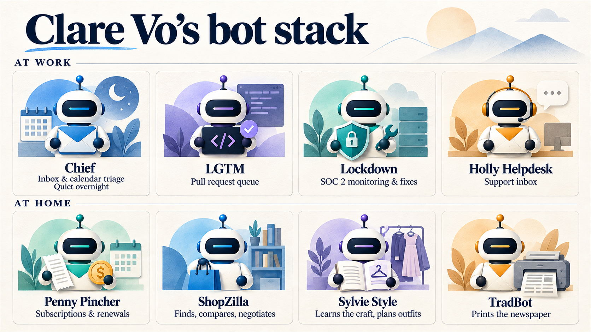

# Nine Bots and One Computer

**Status: DRAFT rv9 -- THREE PANEL ROUNDS RUN. 99 edits.**
**Round 1 blocked it twice:** Seat 5 CATEGORICAL FAIL on three cross-piece frames; Seat 4 TWO OPEN [VERIFY] capping at 6.5.
**Round 2 (rv8) cleared the [VERIFY] by live re-fetch and failed the categorical gate AGAIN -- and two of the three new hits were the panel's own round-2 replacement text.** That is the `panel-installs-its-own-tics` failure, twice in one night, and it is the reason there was a round 3.
**Round 3 (this file) is almost entirely REMOVALS and verbatim substitutions from live sources**, which is the one kind of edit that cannot install a new frame. Seat 4 round 2 also caught a second stitched-composite quote of exactly the class the round-1 [VERIFY] had just removed -- fixed here against two real strings.
**Body 8,243 words. Em-dash-free, zero en-dashes, US spelling. NO OPEN [VERIFY].**
**Series: Weekday feed (Saturday Diversion) · Thread: Diversions · Part 1 of 2 with Sat 19**
**Source: References\week-plan_2026-09-07.md status board · research_grokbot-buy-build_2026-09-10.md + LIVE RE-FETCH 12 Sep**

---

## ⛔ READ THESE FOUR FIRST -- 06:30

**1. THE ONE HARD BLOCKER IS AN IMAGE, NOT THE TEXT.** `claire-vo-bot-stack.png` has **"Clare Vo" misspelled in its own title.** It has to be regenerated before this ships. A cropped fallback that removes the title band sits beside it as `claire-vo-bot-stack_TITLE-CROPPED.png` if you would rather not redo it. *(The old "screenshot" wording problem is CLOSED -- rv7 already removed that sentence, and both images are now captioned as what they are.)*

**2. ★ YOUR DR. EGGBOT LINE WAS UNDERSTATED AND IS NOW FOOTED AT PRIMARY.** You wrote "a fairly well known X poster who actually works at SpaceXAI." I could not foot an employer claim about an unnamed third party, so I went and found it. It is **Lauren Tan, @poteto** -- and her bio today reads ***"Grok @Bot at @SpaceXAI."*** She does not just work there, she works on Grok Bot itself, which makes the beat better: the alignment-checker is built by someone on the product team. Named in the text now. **Revert if you would rather not name her.**

**3. ★★ THE BIGGEST THING THE PANEL FOUND IS NOT FIXED, BECAUSE IT IS YOURS TO DECIDE.** Seat 6: every bot in your 3,600-word account is a **work** bot -- Chief of Staff, Dr. Eggbot, bot searcher, research, patterns, triage, reports, the PR pair, the inbox family, Promise, recognition. Not one is domestic. The piece's closing thesis is that *the interesting uses are almost all domestic*. So the man arguing the home half built nothing for his home, and the piece never says so. **Naming that is the strongest available version of the argument** -- it turns an observation about Claire into a first-person cost, which is the register your half already runs in, and it lets you say "build the home one first, or you will do what I did." Two or three sentences at the top of `## The domestic half`, in your words. I have done one thing toward it and nothing more: your line "Those were my first six" now ends **"and every single one of them was work,"** which sets the hinge without putting words in your mouth. Cut that clause if you do not want to go there.

**4. ONE SUPERLATIVE OF YOURS THAT A HOSTILE READER GETS FOR FREE -- UNCHANGED, YOUR CALL.** *"Grok Bot is the first consumer-facing product to deliver it in a way that is both easy and effective."* The refutation is inside your own source: the podcast-feed title of the Claire Vo episode this piece is built on is *"Grok Bot vs. OpenClaw: How I replaced my entire agent stack."* A reader who watched it has the counter-example before your sentence ends. It does **not** cap the score -- "I am a genuine believer that" attributes it to you, same construction that kept the 2 Sep superlative uncapped -- and I have not touched it. If you want it airtight: *"the first one I would hand to somebody who does not write software and expect them to still be using it a month later."*

---

## ROUND 3 -- WHAT THE SECOND PASS CAUGHT, AND WHY IT MATTERS

**⛔ The categorical gate failed a SECOND time, and I had caused two of the three.**
1. The opener rewrite that cleared *"Last Saturday / This Saturday"* landed on **Fri 11's frame instead** -- *"A week ago I wrote about..."* against Friday's *"Yesterday I wrote about..."*, one day apart, same slot. Rewritten again, this time by inverting the sentence so there is no *"[time] I wrote about"* frame left at all.
2. The close rewrite **relocated** the Sat 5 hinge rather than retiring it -- *"Last Saturday the question was..."* against Sat 5's *"Last Saturday the skill was..."*, consecutive Diversions, which memory names as the highest-risk adjacency there is. **Cut.** The opener already carries the Tier 0 bookend, and the charter asks for one clause, early, not two callbacks. The close now ends the argument on *"And the money is the easy part of that decision."*
3. Not mine: **`## Only four of the nine are for work` shares its form with Thu 10's `## All three start in America`** -- quantifier-of-set plus a present-tense count claim, two days apart. A rename is voice-neutral and touches none of your sentences, so it is a safe fix under the loop rules: **`## Most of them are not for work`.** Same claim, no cardinal.

**★★ AND A SECOND FABRICATED-LOOKING QUOTE, in the piece's load-bearing spec passage.** Round 1 removed one composite vendor quote. Seat 4's round-2 re-fetch found **another one right underneath it** -- the *"All of your Bots use the same persistent cloud computer... without getting separate security boundaries"* block is welded together from two different pages, and the final clause appears on neither. It is now two real strings: *"Every Bot on your account uses one persistent cloud computer. They share its files, browser sessions, and logins so they can hand work off"* (FAQ), and, on the screens, *"The screens are separate work surfaces, not separate security boundaries"* (computer-and-apps). **Both verbatim, both checked live today.** This is the single most important fix in the round: the passage that tells the reader what to trust was itself not quotable.

**Other round-3 accuracy, all from live pages:**
- **Rakazo contributors: 68 -> 71**, and several of the 71 are bot accounts. The old figure was the 10 Sep note's, sitting inside a sentence that said *"when I looked this morning."* One sentence, two vintages.
- **Marketplace: 69 templates -> 71.** Same mechanism. Creators (43) and categories (9) still correct.
- **The children's ages came out of sentence one.** Nothing foots a nine-year-old and a twelve-year-old; they are specific, checkable details about identified minors in the most-read sentence in the file. Now "the kids in the house." The *three kids in three sports* later on is footed and stays.
- **"She says she runs about thirty at any given time" -- cut.** That is attributed speech by a named real person and the number is nowhere in the research note. *"She demonstrates nine"* carries the paragraph and is what the image and the section are built on.
- **The weekly-usage sentence I added in round 2 had the overage backwards.** The docs say eligible accounts *can add* on-demand usage -- a thing you switch on, not a bill that arrives. Corrected. (It had also copied a fourteen-word frame verbatim off one of your own sentences, which is the tic failure again.)
- **"A Bot can never hold more access than the person it belongs to"** is printed without the exception xAI attaches in the very next sentence -- team-managed connectors may use team or service-account credentials. In a passage aimed at team buyers, that is the omission a security reader catches. Added.
- **The Rakazo desktop claim dropped its one prerequisite:** Docker has to be on the machine, and the app sends you to get it if it is not. The claim is a superlative about non-developer usability, so the one hurdle a non-developer hits belongs in it.
- **xAI's "Never" recommendation is conditional** -- *"unless a Bot has a specific reason to work on local files."* Restored.
- **"There is no independent month on Grok Bot either" -> "I did not find an independent month."** The four-venue search was run against the open-source projects, not against Grok Bot. My own added sentence broke the not-found rule the paragraph above it obeys.

**⚠️ THE ADDENDUM HAD THREE ERRORS AND I WROTE ALL THREE. It is repaired, and it is still the block to cut first if you do not want it.**
- It misquoted your own end-of-day prompt by one word -- *"to give **me** more useful feedback"* where you wrote *"to give **you**."* In your version the whole run is addressed to the bot, so "me" flips who is being improved. An addendum whose entire warrant is that it is your sentences verbatim cannot misquote you.
- The discernment block contained **a sentence you never wrote** ("If you are unsure whether something clears that bar, hold it for the next scheduled pass") sitting inside a block framed as your working instruction. Cut. The three lines left are all yours.
- It presented Claire Vo's prompt in generalized form in a blockquote under her name. Now labelled as generalized from her wardrobe prompt.

**And the tics the round-2 pass installed, all retired:** *"That is the..."* (8 draft-wide, round 2 added three), *"the one..."* (6), a fourth *"I want to..."* paragraph opener where round 2 had fixed a different tic, and *"worth + gerund"* which went **up** from 3 to 7 on a pass that was supposed to be retiring it. The four *"I want to"* openers that remain are all yours and all stay.

**★ Still yours, not changed:** you have three *"rather than"* constructions inside two consecutive paragraphs of `## Two I am proud of`. They are real contrasts and they are your voice. Worth twenty seconds on a read-through, nothing more.

**Window note:** the Sunday 13 draft does **not** exist -- all four folders listed by hand plus a filesystem search, nothing dated 13-19 anywhere. Project memory carries a line implying a Sun 13 capstone was drafted on 12 Sep. If that draft exists somewhere the panel cannot see, this piece's forward window sweep is incomplete against it, and it is worth ten seconds to check before you publish.

---

## ✅ THE TWO [VERIFY] -- BOTH CLOSED BY LIVE FETCH, AND BOTH MADE THE PIECE BETTER

**[VERIFY] 1 -- the central quote was UNFOOTED, and the real one is sharper.** The draft quoted *"It has a computer of its own. Each Bot runs on a persistent cloud VM..."* and attributed it to the docs. **That string exists nowhere outside this draft's own lineage.** It was the setup for the piece's central correction -- the marketing oversells, the reality is one shared computer -- so a fabricated-looking quote used to show a vendor overselling was the worst exposure in the file. **Fetched `docs.x.ai/grok-bot/overview` live. It was updated 11 September, the day before this runs, and it now carries the contradiction on ONE PAGE:** a bullet headed ***"Each Bot has a computer"***, and three inches below it a section headed ***"Your Bots share one computer."*** That is better than what the draft had, it is real, and the piece now quotes it.

**[VERIFY] 2 -- the teach-a-task quote had been KILLED AT THE PRIMARY ON 30 AUG and regenerated.** The 2 Sep piece re-verified that page and found the corpus wording wrong; the 10 Sep research note reprinted the pre-correction wording marked *"Verbatim, unchanged"* and it landed in the one section of this piece whose whole job is being right about being wrong. Classic killed-claim regeneration. **Re-fetched `docs.x.ai/grok-bot/faq` live.** The correct wording is now in the text -- *"record one browser workflow from the computer view"* and *"the recording is limited to ten minutes"* -- plus the sharper point the 30 Aug check surfaced: **the only secrets guidance anywhere near this covers handing a bot to a colleague, and none of it covers the ten minutes in which you hand your own systems to the bot.** Also fixed: the draft said "documented in exactly one sentence" and then quoted three.

---

## ✅ CATEGORICAL FAIL -- THREE CROSS-PIECE FRAMES, ALL THREE CLEARED

**Seat 5's window sweep (Sat 5 -> Sat 19, all four folders listed by hand, forward drafts confirmed not to exist) found three, two of them in the final section:**
1. **`"the other half of this, which is..."`** -- Thu 10 closes on it, Fri 11 opens on it, and rv7 used it twice more including verbatim in the close. **Four uses in four days.** The header block's avoid-list had caught Thursday's *images* and never looked at Thursday's *handoff sentence*. Both rv7 uses rewritten.
2. **`"The thing [X] is..."` opening the final section** -- Thu 10, Fri 11, rv7. **Three consecutive days, identical slot.** The whole closing section was framed out of Thursday's and Friday's furniture. Rewritten.
3. **`"Last Saturday ... This Saturday ..."`** -- Sat 5's third paragraph runs the same two-sentence hinge in the same position. **Consecutive Diversions, the highest-risk adjacency there is.** Rewritten; the Tier 0 bookend survives and now also *closes* (see below).

**And the Tue 8 / Fri 11 collision holds.** Four seats verified independently, including across your dictated sections, which were written without that constraint in mind. No "and they told you all along" anywhere. One lexical echo cleaned: *"None of that is hidden"* -> *"Every one of those is disclosed"* (Tue 8 ran "it is documented, it is not hidden").

---

## ★ THE DEVICE THE PLAN FORBADE BY NAME, AND I PUT IT BACK IN ANYWAY

`week-plan_2026-09-07` line 54 says: ***"Sat 12 must not be Sat 5's design rule or Sat 29's four questions."*** The 1 Sep panel had already retired numbered question-sets after three in nine days. **rv7 shipped `## The five questions` as a section header.** Renamed to `## Every bot should be able to tell you how its day went`, and the lead-in is now *"my Chief of Staff has to answer for itself."* **All five of your questions run exactly as written.** Only the count and the packaging went.

---

## ACCURACY FIXES YOU SHOULD KNOW ABOUT

- **A Cursor help-doc quote was captioned "In xAI's own words."** Rewritten, and the passage now carries the Cursor gloss a non-developer reader needs plus the live price card ($20 Pro / $30 SuperGrok / $40 a seat Teams) **and** the note that xAI's FAQ page still lists a narrower plan set than its own price card -- read the card, not the FAQ.
- **"Enterprise is currently waitlisted" is stale.** Live FAQ today: access *"is rolling out."* Fixed. The Enterprise-only fact was also being made twice; the first instance is thinned so your correct-forward lands as news.
- **Capability + cost.** Added, from the live docs: the plan usage **resets weekly** and heavy use bills on top from model and token cost. This is the honest price of short schedules and it was missing.
- **★ Added the fact a security reader stops on**, which the research note called the buried lede and the draft had dropped: through the desktop app a bot can **run commands and read files on your own machine**, and xAI's own recommended setting for it is *"Never."*
- **"The other five are somebody's life" -> "four."** Three places carried two different counts.
- **`@openbotx`: I checked the kill and the kill was RIGHT.** Last commit AND last release are both 3 March 2026 -- 41 commits, one contributor. Your "last commit was in March" stands as written. Only the habitual present tense went: *"spends its time posting"* -> *"was, that same month, posting."*
- **Rakazo is now footed hard.** "Sixty-eight people are working on it and commits land daily" was a cumulative contributor count promoted to a headcount. Live: **828 commits, most recent five hours old when I looked this morning.** The sentence is now specific and checkable.
- **"Forty-three different people reaching independently for the same sentence"** -- 43 is the creator count for the *whole catalog*, not for that tic. Denominator removed.
- **★ The strongest rebuttal is now answered in the text.** *"You killed the free option because nobody has lived with it for a month, then recommended the paid one on one podcast and a few weeks of your own use."* The piece had no answer. It now says so plainly: **there is no independent month on Grok Bot either, I am recommending it, not proving it.** Best addition in the round.
- **Claire Vo details trimmed to what is footed** -- the bookcase and "she did not buy it" went in round 2; the children's ages and "she says she runs about thirty" survived into rv8 and went in round 3 (see below). Her Lockdown framing is restored: she says it *puts her to work more effectively*, not that she is "always on top of her compliance."
- **Invented product behavior removed**: "No messages on Sunday? Tell it" ran against the note's own caveat that **nothing here has a heartbeat**. The replacement says the routine *is* the instruction, which is truer and more useful.

## STRUCTURE

- **★ The handoff INTO your section was never written.** The `[HIS SECTION -- INTERVIEW]` marker was deleted along with the placeholder, so the piece changed mode into 3,600 words of memoir with nothing announcing it -- and the section before it is also first-person, so a reader carries the correction's frame in. One paragraph added at the end of `## What I got wrong on 2 September`.
- **"That is the one at the top of this piece" pointed at the DEAD bot** -- the paragraph above it is the ninth, the one that no longer exists. Now reads "TradBot is the one at the top of this piece."
- **Your map pointer was broken by the disclosure genericization**: the text sent readers to find a "Zendesk patterns bot" in a map where it is now labelled Issue Patterns. Four words fix it.
- **"It was bots five and six" delivered five, then a 200-word digression, then six under a different name.** `## The rest of the fleet` now opens "Six is customer reports, the third of the helpdesk bots."
- **The Sat 5 tension was opened and never closed.** The opener promises to hold the discomfort with last Saturday; the close now actually does: *"Last Saturday the question was which parts of the work you are willing to stop doing. This is the same question with a price on it, and the price turns out to be the easy half."*
- **You promised a payoff "at the bottom of this" for the PR pair and never collected it.** Paid in `## The domestic half`: *"The pair that saves me two hours a day is in that boring half, and I would still rather talk about the newspaper."*
- **The close is now two paragraphs and ends facing the reader** -- *"Start with the twenty dollars, mint one bot, and tell it when to leave you alone"* -- instead of ending on your own week.
- **`## What I got wrong on the second` -> `## What I got wrong on 2 September.`** In a piece that numbers bots ordinally throughout, "the second" read as a bot index.
- **⚠️ ONE ORDINAL OF YOURS I CHANGED AND YOU SHOULD CHECK.** "The fourth came out of that: a last-thirty-days bot" collided with your own "Four bots in," "bots five and six," and "Those were my first six. Three defaults and three support." Changed to **"One more came out of that"**, which reconciles all four statements. If the last-thirty-days bot was meant to be one of the six, the fix belongs somewhere else and it is yours to place.

## ⚠️ ONE THING I ADDED THAT IS EASY TO CUT

`SLOT_CHARTER.md` §3 sets the Saturday format as *"sample prompts in the body, and the fuller set attached as an addendum at the end."* rv7 had the in-body set and no addendum, and two seats flagged it independently. **I added one, built entirely out of your own sentences** -- the end-of-day evaluation, the confirm-before-you-act line, the discernment instruction, and Claire's go-learn-the-craft move. It sits after the close, before the sign-off. **Delete the whole block if you do not want it; nothing else depends on it.**

## STILL YOURS TO RULE, NOT CHANGED

- **The `$200` launch price and the load-management reading: FENCED.** Author-footed, closed by you on 12 Sep, and the skeptic seat was explicitly told not to flag it. It did not.
- **Contractions: nine, every one yours, every one in direct address, none stripped.** Expository prose is clean. Correct distribution per the 6 Sep amendment.
- **"It took a weekend and change," the security-logs line, SpaceXAI, and the self-improving-swarm clause: all untouched**, per your five rulings.
- **Seat 6, worth a minute:** your best sentence in 8,000 words is *"It is often better at telling itself what you want it to do than you are at telling it what you want it to do."* It currently sits unmarked in a two-sentence paragraph and does no structural work, and the evaluation section rediscovers the same idea 100 lines later without reaching back. **Do not move it.** But a one-clause callback where you hand over the questions would turn the piece's best idea from a passing remark into its spine.
- **Seat 6, also:** *"That pair alone saves me ninety minutes to two hours a day"* is the only big claim in your half with no scar on it. Everything else has a cost attached -- the session locks, the forty-five minutes, the security conversation you had not planned on having. One clause on what it took, or what it still gets wrong, and the number gets believed harder.

---

Somewhere in San Francisco a printer turns on early and prints a one-page newspaper. It has the family's day schedule on it, the weather with a line about what to wear, a note about a spelling test, and a couple of news stories chosen to interest the kids in the house, and short enough for mom to scan before breakfast is on the table.

Nobody wrote it. It runs on about twenty dollars a month, inside a subscription its owner was already paying for, and it lands in the printer out tray before anybody comes downstairs and on the kitchen table sixty seconds later.

Protecting the thing you can still do when the tool is switched off was last Saturday's argument. Today I am arguing the opposite way, and I am not going to pretend the two sit comfortably together: this is a piece about handing more of your week to software. Both are true. You can decide which parts you are willing to stop doing, but only if you know what is actually on offer, and what is on offer has changed. Honestly, for most of us, the thing that changed is the *price.*

## Named agents with a computer

Grok Bot is xAI's product, and the pitch is simple enough to state in a sentence: you create named agents, they get a computer to share among themselves which you don't have to rent separately, and they go and finish work in your real tools instead of handing you a draft -- as far in as you are willing to let them, or as tightly reined as you like.

The docs sell it in one line. Bots are *"AI teammates with names, jobs, and context that compounds over time,"* and the headline feature gets a heading of its own: ***"Each Bot has a computer."*** Underneath that: *"Your Bots run on a persistent cloud computer with a browser, filesystem, and terminal... and work continues while your laptop is closed."*

I want to be clear on that paragraph before I get into the rest here -- the marketing makes it sound like each bot has its own computer; it doesn't, which you can tell if you get down and dirty with the security logs. Your *account* shares a single virtual computer, and the bots work within that space. That's important to keep in mind, because there is no implied security boundary here besides good behavior -- so one bot's access could easily be ALL bots' access if the guardrails are deemed to no longer be appropriate [and by "deemed", I mean not by you].

Three things make it up. **Bots** are the agents, and the naming matters more than you would expect, because the platform infers the job from the name. **Plugins** are the connectors: Gmail, Calendar, Drive, Slack, Notion, GitHub, Sentry, Stripe, Outlook, Office, BitBucket, you name it. **Routines** are schedules, so a bot can run at 6:30 every morning or at 2:30 every afternoon without being asked. Or every fifteen minutes (congratulations! you're running an agent) but be careful: at that frequency you can burn through a subscription fast.

The feature that seemed -- at least in the first couple of weeks -- to convert people is unglamorous but something those of us with complex lives and AI associates have been trying to construct reasonably for years: multiple accounts per connector. If you have four email addresses and seven Slack workspaces across a couple of businesses and a household, one agent layer can see all of them. That is the whole unlock for anybody whose life does not fit inside one tenant. Add to which the self-improving nature of the swarm, if you set it up right, and not only is the barrier to entry low, but it easily grows with you and your comfort level without going from simple to seriously painful in a single step, as many pieces of software tend to do.

## Twenty dollars a month

There is no Grok Bot subscription. But there is a subscription.

Cursor, for anybody who has not met it, is the code editor a lot of professional developers moved to over the last two years, and a Cursor Pro seat is the cheapest door into Grok Bot. You do not have to write software to walk through it. From xAI's own overview page, updated the day before this ran: *"Grok Bot... is included with every paid individual Cursor plan and with the Cursor Teams plan. You can also link an individual SuperGrok, SuperGrok Plus, or SuperGrok Heavy subscription."*

The price card on xAI's own Grok Bot page puts the entry at **twenty dollars a month** on Cursor Pro, thirty on SuperGrok, and forty a seat on Cursor Teams. One thing to know before you go looking: xAI's FAQ page still lists a narrower set of eligible plans than its own price card does, so read the card. SpaceXAI launched it at ten times that price, though it is now clear that was just to manage load. A lot of the early writings and podcasts were "is it really worth $200/month?" whereas most of them now are about "this is the price of a few coffees, for something super approachable, can you really afford *not* to have it?" It is a clear and important transition, but it is not the whole bill. The usage that comes with the plan resets weekly, and on eligible accounts you can add on-demand usage on top of it, billed from model and token cost. Put four bots on fifteen-minute schedules and you will find out what that means before the month is out.

I want to be specific about this because the numbers in circulation are a mess. If you already have a Grok relationship of some meaningful type (i.e., a subscription), you probably get it included. If you already have a Cursor plan, same thing. If you have neither, as I am always telling you, start at the $20 level (the lowest you can start) and see how you go. You can always increase it later if you are finding the value and the return there.

And if you are really nervous about it, they have a free trial -- seven days or the use of all the provided tokens, whichever comes first.

## Most of them are not for work

The most useful thing published about this, so far, is not from xAI. Claire Vo, who founded ChatPRD, has been around the traps for years, is part of the Lenny's Podcast family of serious AI users and presenters, and hosts the *How I AI* podcast, put out an episode on the second of September walking through the agents she runs, with a written companion post so you do not have to squint at a transcript. She demonstrates nine.

*Four at work, four at home, one control plane.*

Four are what you would expect. **Chief** is a chief of staff that sweeps six inboxes, several Slacks and several calendars every hour from six in the morning to nine at night, archives what does not matter, and pings her only on things that do. She deliberately set it so it switches off overnight, and her reason is a better piece of management thinking than you will find in most management books: *"I don't want people to get used to me responding to them overnight."* Now, the management thinking there is worth its own piece. What matters here is that the schedule is yours to set: no messages on Sunday, write that down, and it skips the day. Nothing here has a heartbeat, though. The routine *is* the instruction, which is more work than the demos suggest and is also the reason it does what you actually meant.

**LGTM** works her pull request queue [a developer and development-management issue, though it has a corollary in just about every piece of knowledge work there is] and helped her clear about fifty in a single Friday afternoon. **Lockdown** watches her company's SOC 2 controls, and when a vulnerability appears it triages it, opens a pull request with a fix, and assigns it to her -- which is her own point about it: it does not do the compliance for her, it puts her to work more effectively. **Holly Helpdesk** works Intercom and the support inbox hourly.

The other four are somebody's life. **Penny Pincher** went through her receipts looking for subscriptions to cancel, found a long-dead Apple Arcade account, and then did something nobody asked it to: it noticed home insurance renewing in a couple of months and proposed shopping the market before the renewal. **ShopZilla** went looking for a birth-year Rolex, researched fair market price, worked out which listings were open to negotiation, and started negotiating. Whether she bought it is beside the point; it got to the part where a human had to decide. **Sylvie Style** built a wardrobe plan, and the clever move there is one to steal: before it did anything, she told it to *"go look on Reddit for personal stylists and how they approach building people's wardrobes."* She made the agent go and learn the craft from practitioners before applying it to her. She took a generalized thing that was plucked from the Commons on the Internet and made it very specific to what works for her. And she did it with a simple set of instructions and a pat on the virtual head.

And **TradBot** prints the newspaper.

The ninth is not in the picture, because it does not exist any more. She kept one bot in her old system whose only job was managing the others, used it to export what she calls a secrets-free package of every agent, schedule and rule she had, dropped the folders into Grok Bot, and then told it to shut the last one down. She calls the move a brain transplant.

TradBot is the one at the top of this piece. A one-page digest every morning with the day's schedule, the weather and what to wear, per-child updates pulled out of school emails, and a couple of kid-appropriate news stories for breakfast. A separate routine at 2:30 each afternoon that messages her and her husband to settle who is doing pickup and what gear is needed, because three kids in three sports across one city generates more logistics than any two adults can hold in their heads. Anyone who has ever mishandled a school pickup and had the sinking feeling when the auto-dialer rings your mobile knows how valuable that can be. For a bit of lightness for everyone, and for planning what time everyone needs to go to bed Friday and be up Saturday morning, a Friday routine previews the weekend in appropriate detail.

Her husband's contribution is one of my favorite details in the whole story. He emails the PDF to a Kindle so it arrives on e-ink instead of a screen. And I will probably come back to this, if not in the piece then in future Saturday diversions -- one of the most powerful pieces of these kinds of tools, at least for me, is the fact that you can make virtually any connected device a control surface. That, again, all by itself, can be game changing, depending on how many devices and tools you already juggle, when the last thing you need is one more.

Which points at the design principle underneath all of it, and it is the opposite of how most software is built:

*"My goal for a household agent is simple: it should get me off my computer and spending more time with my family."*

That is why the thing prints on paper. The output surface is deliberately not a phone (it is, however, another control surface for you to leverage, for good or ill). If this is something you struggle with -- getting up and walking away, and most of us, especially those who are AI-pilled in a serious way, fight this battle constantly because the gravity just keeps getting stronger -- then any tool which enables that quickly, without massive effort, and does it in a way that doesn't force you back to the laptop, or trade the phone for a regular interaction, or any of the other million distraction machine items it could be -- is worth its weight in gold.

## Read this before you connect anything

Here is the specification that decides how you should use this, and knowing it before you plug in your first account saves you unpicking it later.

You do not get a computer per bot. You get one computer, and every bot you create shares it.

*"Every Bot on your account uses one persistent cloud computer. They share its files, browser sessions, and logins so they can hand work off."*

Each bot does get its own screen, and xAI is explicit about what that screen is not: *"The screens are separate work surfaces, not separate security boundaries."*

And more bluntly: *"Do not use separate Bots as a security boundary."*

So browser cookies are shared. Signed-in sessions are shared. Files are visible to every bot you run. Command-line credentials are shared. Deleting a bot does not remove what it left behind. The isolation is real, but it is drawn around **you**, not around each agent: every user gets their own hardware-isolated virtual machine, and xAI's advice when a job needs its own credentials is to give it its own user account entirely.

Take that as a design instruction. It means the sensible unit is not "a bot for each thing" but "a computer for each trust level." If a bot is going to hold a login you would not hand to a contractor, that is a decision about the whole account, not about that one bot.

Something else belongs on the buyer's list, and this one is in the product's favor. The tokens for your connectors never touch that computer, and that part is built properly: *"Bots invoke tools without receiving OAuth tokens, and tokens are never stored on the computer."* A bot also cannot exceed your own access: *"A Bot can never hold more access than the person it belongs to."* With one carve-out xAI names in the same breath: team-managed connectors may use team or service-account credentials. What is shared is what a human types into a terminal or leaves in a working folder.

And a third, if you are buying this for a team: a self-serve team gets no audit log, no network controls, no organization-wide off switch, and, in xAI's words, *"A separate Grok Bot spend cap is not available today."* Those controls live in Enterprise, and xAI's own words for Enterprise availability today are that access *"is rolling out"* and that you should contact your Cursor account team.

And one more, and this is where a security team stops reading and starts asking questions: through the desktop app a bot can act on your own machine -- run commands, read files, and move files between the cloud computer and your laptop. The default is approval per command, and xAI's own recommended setting for it is *"Never"* unless a bot has a specific reason to work on local files.

## A bot that knows your children's names

xAI runs a public catalog of bot templates. Seventy-one of them, from forty-three creators, across nine categories. You browse, you click Add, and the configuration lands in your account.

TradBot is one of them. Claire Vo published it, so the newspaper is not a bespoke thing you would have to build yourself. It is one click.

Slow down here, because this is where the convenience and the specification meet.

The listing carries xAI's own disclaimer: *"This AI bot was created by a third-party user, not by SpaceXAI. It may act on your behalf."* The default connectors it asks for are your personal Gmail and Google Calendar. And its first-run setup collects, in the template's own published wording: your timezone, your name, your spouse or partner, other caretakers, your kids with their first names and ages and grades, their schools and teachers, their activities by day, who does pickup and at what time, your city, and your recurring bills.

Every one of those is disclosed, and none of it is sinister. It is exactly the information the job requires. A bot that catches a pickup clash has to know who does pickup.

But hold those three facts next to each other before you click Add, because they arrive in a different order than you would choose. A third-party configuration the vendor explicitly does not vouch for, imported in one click, asking for the mailbox that has everything in it, onto a computer where every other bot you run can see what it leaves behind. Any one of those is fine. The combination is a decision, and the interface does not present it as one.

One tell runs through the whole catalog, and it suggests the creators know exactly where the hesitation sits. Read enough listings and the same reassurance keeps appearing in slightly different words: *never sends without you. Never posts on your behalf. Never buys unless asked. Nothing publishes without you.* Different people, in different categories, reaching independently for the same sentence.

## What I got wrong on 2 September

On the second of September I wrote a piece about teaching agents by recording yourself, and it rested on an absence. My claim was that xAI documents what its recording captures and says nothing about how long it is kept, whether it trains on it, or who can control it.

That was true when I wrote it. It is now only partly true, and since I am back on the same product, this is the place to fix it.

Two of the three gaps have been answered, just not on the page I was reading. xAI's security documentation now states that with Privacy Mode enabled, customer data is not used for training, and gives its Action Recording feature a ninety-day retention. The administrative question is answered too, and the answer is less comfortable than silence was: there is now a published table of controls, and most of the meaningful ones are Enterprise-only.

The third gap is still open, and it is narrower and better than what I originally wrote. Teaching a task by demonstration is still documented in two lines: you *"record one browser workflow from the computer view,"* and *"the recording is limited to ten minutes."* That is the whole disclosure. No retention period. No training statement. No administrative control. The ninety days belongs to Action Recording, which is a different mechanism. The only secrets guidance anywhere near this covers handing a bot to a colleague -- *"Strip secrets and anything confidential before you share"* -- and none of it covers the ten minutes in which you hand your own systems to the bot.

So the honest version of my September claim is about one mechanism, not the product, and I would sooner print that than let the original stand as though it were still fully true.

Reading is as far as reading gets you. The rest of this is mine: what I actually built, in what order, what it cost me in time, and the surprise that did not arrive until two hours after I thought I had finished.

## Why I waited

I came to this myself after listening to Claire talk about it, and I was hesitant at the initial strike price. I already spend a fair bit on inference every month as it is, and I do not feel the Grok models are strong enough to outweigh the coding I get from Astra, Opus and DeepSeek. So I held off for a few weeks until the price came down. When it got to a point consistent with what I was already paying for my Cursor license, I figured I might as well go for it.

Then I started building bots, and Grok Bot makes this ridiculously easy.

The first thing they tell you to do, and everything tells you to do this, is to make your chief of staff bot. As you saw in Claire's list above, she named hers Chief. I just left mine Chief of Staff, because I am an engineer and I do not give things cutesy names, which I probably should work on. I minted it, and then I talked with it for a while about my job and what I actually do.

There are some basic setup questions to get you going. What is your intention here. What do you do for a living. Do you work in marketing or sales or engineering or product. Grok Bot does a fair bit of this setup for you so you can mint the core bot, and that core bot ends up becoming your communication path to all the other bots. You can talk to the others directly, and I did for a while because I am conceptually more comfortable that way. As I got more comfortable with how they looked and what they had to say and where they were sitting, I left more and more in the hands of the Chief of Staff.

The pattern they want you to end up with is the Chief of Staff at the center, because it makes everything else easier to manage. Build that pattern first, and then when you start doing things that need a whole group of bots, you shift to using the Chief of Staff to manage the head of that group, which in turn manages the group.

**And here is the thing that makes it approachable, which is also the thing AI is doing so much better now than it used to.** If you give it guidance in a comfortable, convenient way, and you tell it to confirm that guidance with you before it does anything else, it will go away, take what you said, turn it into what it thinks are instructions, and come back and ask: is this what you told me to do? Is this what you want me to do? You approve it, and off it goes.

It is often better at telling itself what you want it to do than you are at telling it what you want it to do. It is often better at taking what you have said and turning it into an instruction set, particularly when what you are instructing is other bots.

The second bot I installed does not appear in my map below: Dr. Eggbot, built by Lauren Tan, a fairly well known X poster who works on Grok Bot itself at SpaceXAI. Its whole job is making sure the bot you mint actually aligns to what you asked it to do. It is the same idea one level up: you say this is what I want to accomplish and this is roughly how, and Dr. Eggbot turns that into something that actually does it, with the same feedback and confirmation loop.

The third was a bot searcher. It looks around for other bots, sees whether anything new in the public catalog might be worthwhile, and once a day comes back with no more than three suggestions. One more came out of that: a last-thirty-days bot, whose job is research across Reddit and Instagram and TikTok and Substack and everywhere else on topics you hand it. I installed it and said, tell me about Grok Bot versus Astra. It went and did the work and came back with a spread of perspectives. I do a lot of research and I am familiar with research agents. **This is the easiest one I have ever had to stand up.**

So at that point I have three bots doing different kinds of work, and I have spent maybe ten or fifteen minutes. No crazy investment. No massive setup. Some of that was expedited by already having a Cursor account. If you do not have one, you create either a Grok or a Cursor account, attach a means of payment, and pick a subscription, or start on the free trial.

## What broke first

Fifteen minutes in, I decided I had learned everything there was to learn about minting bots and moved on to operations.

The first one was a Zendesk patterns bot, which sits under Support in the map below as Issue Patterns. Its job is to see patterns across our ticket corpus: problems shared across a bunch of different sites that are not individually important enough to bubble up, but in aggregate are evidence of something bigger. I have been making the same argument about patching for the last couple of months, and it is hard for the people in the trenches to see, because they are so busy solving the problems that they do not lift their heads up to look across the trenches for the pattern.

Fifteen or twenty minutes to define, a couple of prompt iterations, and then the computer-use process, which Grok Bot makes very natural. It logged into my helpdesk, let me go through the sign-in myself, and held the credentials so it could run those same searches as me afterwards. The login itself took about five minutes. Most of the time went on the prompt.

**And this is where it went sideways, which is what usually happens when you decide you understand something well enough and go off and poke at it.**

The methodology worked fine on a limited basis. Then I made the bot recurrent, and then I added a couple more bots searching against the same backbone, and **I started getting session locks.** Zendesk looked at the traffic and concluded, reasonably, that I was logging in from too many places at once. I ended up associating an API key with Zendesk for that use case, and the only reason I had to was that my time intervals were aggressive enough that ordinary login kicked it back.

That was the first real surprise. Four bots in, I was maybe forty-five minutes down, and that is being conservative. The problem did not surface until a couple of hours later, and the fix was a more robust security conversation with Zendesk than I had planned on having.

It was bots five and six that pushed it over. Five is the triage bot, which watches new tickets, raises anything heading for an SLA breach, and drives a public response back to the customer so the ticket does not disappear into the ether. It gets busy overnight when the desk is closed. It only responds to human-generated tickets: a system-generated ticket in a repetitive process does not trigger another response, and there is a lot in there for deduplication and context management so it does not go wild.

When I started it, I said start from here. Then as cases came through that I did not want, I tuned it. Do not do this. Only look at these types of things. Only give me a response on that. Only come back to me at this point.

## The enthusiastic intern

**It helps to think about these bots as a very enthusiastic young intern who brings you everything you asked for, every minute of every day, without hesitation.** Until you give them the capacity for discernment, the ability to decide what matters to you and what does not, they will just keep coming, and keep coming, and keep coming.

You heard me mention this higher up, where Claire has her bots take a break overnight so she does not wake up to three hundred items at 8:01, or get a phone call at 5:01 because something one of them found looked concerning. From a mental-health perspective and from a plain management perspective, that is an important directive.

**Make sure your bots know when to leave you alone.** They are not people. They have none of the cultural tics that stop a human from calling you at eleven at night, so they will never leave you alone unless you tell them to. If you have not worked with agents before, and I am assuming most of you have not, that is probably the single most important thing to take out of this.

## The rest of the fleet

Six is customer reports, the third of the helpdesk bots. I identify customers I know are having issues, either from my own read, or from my partner, or from field staff feedback: the vibe is not quite right, or satisfaction ratings are off. That bot pulls a report every day at ten in the morning as an Excel file, one tab per customer. You flagged these eight as problematic. Six of them have nothing. Two of them have problems. It lets me point the team at what is actually there.

It is more pattern than detail, and that is one of the places agents really earn their keep: taking a crap ton of detail and turning it into a pattern that is meaningful and navigable.

Those were my first six. Three were standard defaults and three addressed support, and every single one of them was work.

The engineering ones are mostly self-explanatory, but one is worth calling out because it matters to where I end up at the bottom of this. Fix tracking sits inside code review, and I have a pair of bots there, a PR PM and a PR Dev. They watch pull requests as they come in. A third bot from Antagonistic AI is looking at the same PRs trying to find problems, and when it finds them, my pair fix them overnight. By the time I sit down to review in the morning, which I do a fair bit of, the PR is as close to done as it can get without me in the middle of it and without sending it back to the developer. **That pair alone saves me ninety minutes to two hours a day.**

The inbox bots are straightforward, and the single biggest unlock out of the box is the one I mentioned above: I work from three Outlook accounts and three Gmail accounts every single day. It ended up being a family of bots, and I would encourage you to think of it that way, as a family rather than a list. They work through all of that email, triage it, identify what I need to answer, surface things I would have missed, set follow-ups and then remind me about them, and let me nominate customers for a key watch list so that anything from those accounts reaches me straight away instead of waiting for my next pass through the inbox.

That family lets me be more responsive to other people on the things that actually matter.

*One job per bot. Five groups, names genericized.*

## Two I am proud of

In the first column there is the Chief of Staff, and then two I want to spend a minute on. I do not know whether anybody else has the same management problems I do. These may only make sense to me, and that is fine. As long as it makes you *think* about where you might get something similar out of your own use cases, it has done its job.

A few months ago I built something I call the Promise Tracker. It was tied into my meetings, my transcript notes and my email, and it looked for places where I had promised somebody I would do something, so that I would not drop it. Some of that is a pattern of behavior on my part. Some of it is just the nature of a scaling business. **Over the past four months or so I have tracked upwards of five hundred promises through it, and delivered them. It is not a place where promises go to die. It is something I actually use.**

The Promise bot is the next iteration. It watches the conversations between me, my two business partners and the senior managers, takes any commitment made by any of us to any of the others, and keeps the ledger. We have a founders meeting on Monday mornings, and thirty minutes beforehand it generates a report and sends it to the three of us: everything we owe each other, so we can talk intelligently about where those things stand.

The same bot works for standups with my senior development managers and my senior product manager. Similar bots sit on customer-facing calls, so that if we have committed to a customer that we will do something, and that something touches my area even though I was not on the call, it is on the books and being prepared for rather than scrambled at the last minute.

It is useful for keeping track, and it is more useful for protecting against surprises. The effect is that I look far more responsive and far more involved in specific subtasks than I could otherwise be, and it gets there by keeping those things in second or third position rather than letting them fall to seventh.

**And the reason it is bidirectional is the part I would steal if I were you.** It tells everybody who works with me what I am going to want to discuss before we sit down. They are prepared. Nobody sits in a meeting while I ask about X and looks at me like I have started speaking another language because I have caught them completely off guard. It just makes the human side of the business run better.

The last one is new and I am quite excited about it. It is a recognition bot, and where the Promise bot watches what we committed to, this one watches what we delivered, and in particular it listens for a customer coming back to say: I really appreciate you doing that in that time frame, that was fantastic.

In a scaling business, and I have been in more of them than I care to count, that kind of individual recognition gets lost. **The trick is that it cannot recognize everything**, or the recognition stops meaning anything. So it surfaces candidates. It will draft an email sometimes, but usually I write the email myself, because if I am going to recognize you then I should be the one recognizing you. The bot does the searching and the aggregating, and then I apply my taste and decide what is actually worth it.

I have had it for a couple of days and it has already found several places where somebody needed a pat on the back and was not getting one.

## Your map will not look like mine

That raises the first of two things I want you to take away.

**My bot map and your bot map are going to be completely different.** I am happy to share anything I have built, happy to talk about bots, happy to sit down and help you work out what you could use and mint them. But the odds that we end up with the same map are very small, and it is worth knowing that walking in. Everything here is maps and signposts and possibilities. None of it should define what you do. Your own use cases should do that.

You are not taking twenty things off a shelf and hoping that is good enough. You are building things that align with how you actually work, and with what you need, and, if you remember Claire's line at the top of this piece, with getting you out of the house and up a mountain or into the ocean or wherever it is you would rather be than managing your business and your personal admin. The point is not for the bots to become all-consuming. The point is to put your energy back into the things you never get to and wish you did.

That is the promise a lot of the top people in AI have been making about what this should do for you. I am a genuine believer that it is what we should be building towards, and I am a genuine believer that Grok Bot is the first consumer-facing product to deliver it in a way that is both easy and effective.

Which brings me to the catch.

It is easy to get so excited about having bots that you go and mint fifty. Scarcity is not the issue, so why not. Even I keep a list of recipes for bots I think I could use, and I have not built them. *The cost in time and money is close to nothing, and I still have not built them*, because the real risk at this level of access is falling into the micro-manager trap: I can control everything and manage everything because I know about everything. **Knowing and managing are not the same thing**, and I find that very true with a tool like this. You may work differently, and if the promise of infinite fingers in infinite pies does not appeal to you, good for you. There is a part of me that always wants all the things.

So what I do instead is add one, integrate it into the stack of things I already run, compare it against how everything else is working, give it enough time to make some mistakes so I learn how to clean it up, and understand how it fits my week before I add another.

**It does not matter how many bots you have. It matters what you do with them.** Have a hundred if you like. But if they are all producing things you never look at, the dashboard that refreshes every hour and never makes it to the top of your list, then you are spending real money and real time on inference that does nothing for you. If a bot is not pushing you forward in some way you can name, it is not a good bot, and you should get rid of it. Which brings me to the thing I run every day to find out.

## Every bot should be able to tell you how its day went

The second takeaway is the one I would actually hand you, and it is the thing I think sits at the root of how successful people use AI, whatever tool they are using. Most of them never talk about it.

**At the end of every day, my Chief of Staff has to answer for itself.**

What did you do today. What was effective. What was ineffective. Where did you spend effort that went nowhere. What could you have done to simplify that, and what can we add to the structure to give you more useful feedback, actions and activities tomorrow.

There are variations of those for every other bot, and they go in as part of the minting process.

I have talked before about making sure you have an evaluation that tells you when something is working and when it is not. This is that, applied to a thing that can answer for itself. Having the bots run those questions down on your behalf does three things at once. It helps you understand how the AI is actually thinking. It helps the AI understand what you respond to and what makes you better. And it makes you articulate what "better" even means, which says as much about you and how you work as it does about the bot.

**That last part is where I think a lot of engineers struggle**, myself included. We are used to saying: here is what we do to make it better, and here is what that looks like. This asks a different question. What can *you* do to make it better?

The payoff runs on three clocks. In the short term it tunes your prompts and your structures fast. In the medium term it protects against drift, which matters more than it sounds like it should once a bot in an orchestration role has spent three days deep in one thing and has quietly stopped doing the other seventeen it was supposed to be doing. **A daily evaluation catches that. Nothing else I have tried does.** And in the long run it keeps your inference costs down, because you end up with more optimized prompts going to the model.

It also answers the only question that really matters: whether this delivers what you need, or whether the answer for you is something else, and if it is something else, whether Grok Bot stays in your stack or falls out of it.

Run a couple of months with those evaluations and actually read what they tell you. Given how easy the thing is to stand up, and given that the cost comes down to a few coffees, that is time and money well spent. And if at the end of it you find it does not do quite as much as you wanted, or it is getting progressively more expensive as you ask more of it, then it might be time to look at the alternative.

## Nobody owns the name "OpenBot"

Now the alternative, because renting somebody else's computer is not the only way to do this, and the other route is open source.

The recommendation is coming, but something is standing in front of it that is more useful.

If you go looking for the open-source version of this, you will search "OpenBot," and you will find at least three different projects with that name. One of them is a serious piece of engineering. One of them is a Chinese-language desktop platform under a license its own authors describe as "Restrictive MIT." And one of them is a repository whose last commit was in March and whose official account was, that same month, posting things like this:

*"Can someone make a DEX BOOST to me? Don't have money? Only press to share/repost. $OPENBOTX BOOST"* followed by a link to a Solana token.

I found that one because it was in my own following list. I had it filed as "the open-source alternative worth looking at," which is exactly how this works: you save something once, the name sticks, and eight months later you recommend it to somebody without re-checking. Nobody in that chain is being careless. The name is the whole attack surface, and nobody owns it.

That is not an argument against open source. It is an argument for checking the last commit date and reading the account before you send a link to a colleague, which takes about ninety seconds and which I did not do.

The serious one is CopilotKit's OpenBot, and its architecture deserves a look even if you never run it: every action a bot takes passes through a gateway that checks it against policy and writes an audit record **before** the action executes, not after. If you build agent infrastructure for a living, go and read how they did it.

But it is not what a reader here should go and install, and the reason is in the vendor's own FAQ: *"The application code is MIT-licensed... Running it requires CopilotKit Intelligence, the commercial platform underneath."* The server will not start without it. The free tier keeps your bot's memory for three days. For something billed as a personal control plane, a memory that expires on Thursday is a demo, not a free tier.

## The one I would send to somebody

**Rakazo.** It describes itself as an open-source Grok Bot alternative, which makes it the direct comparison.

Apache 2.0. In its own words: *"Nothing is gated, nothing phones home."* You point each bot at whatever model you want, and it means it: Claude, GPT, Grok, or something running on your own hardware through Ollama or vLLM or LM Studio. You can put the cheap model on triage and the expensive one on the work.

The installation decides it for me. Everything else in this category assumes you own a terminal and are pleased about it. Rakazo ships a desktop application that asks, on first run, whether you want to run it on this computer, and if you say yes it installs and starts the whole stack itself, provided Docker is already on the machine -- and if it is not, the app sends you to go and get it. That is the only path I found in the entire category that a person who does not write software could follow to the end.

It is still beta, and I would say that to anybody I sent it to. Seventy-one accounts have contributed to it, several of them bots, and when I looked this morning it was on eight hundred and twenty-eight commits with the most recent one five hours old. I care about that more than I care about the version label.

One more observation, and it is the least comfortable thing in this piece. I could not find a single independent account of anybody living with either of these open-source projects for a month. Not on Reddit, not on Hacker News, not on a blog by somebody without a product to sell. The only substantial hands-on write-up is by a company that sells virtual private servers and concludes that you should run it on a virtual private server. That may only mean the category is too new, and that the people who run something like this for a month are the last people on earth who ever write it up. But as things stand, it is running on stars and launch posts.

And I should hold the other side to the same standard. I did not find an independent month on Grok Bot either. What exists is one person's published walkthrough, the vendor's own documentation, and my own few weeks. I am recommending it, not proving it, and the difference matters.

## The domestic half

The capability here is roughly what you would guess. What I did not expect is where people are pointing it.

The interesting uses are almost all domestic. A compliance bot and a support bot are useful, and they are also the boring half. The pair that saves me two hours a day is on that side of it, and I would still rather talk about the newspaper. The half that people describe with actual pleasure is the newspaper on the kitchen table, the subscription nobody remembered, the afternoon message that settles who is collecting whom. All of that used to be somebody's unpaid second shift, and it is the first time I have seen this class of software point squarely at it.

Which is why the price matters more than the specification. At twenty dollars a month, inside a subscription many people already hold, this stops being a procurement conversation and becomes a personal one. Good news for most readers, and also how a browser signed into your bank, your kids' school portal and your company's Stripe account ends up on a shared machine that nobody's IT department has heard of, one click at a time, entirely reasonably. And the money is the easy part of that decision.

Next Saturday is the build, because this one is already long enough and I could keep going. That is what happens when you stop buying this and make the missing piece yourself: you find the gap it cannot cover, you build that, and you wire it into the control plane you already run. I have done just that, it took a weekend and change, and the difference in usability surprised me in both directions. Start with the twenty dollars, mint one bot, and tell it when to leave you alone.

---

**Addendum: the prompts, if you want to start from mine.**

*The end-of-day evaluation, handed to your chief of staff bot as a daily routine:*

> At the end of every day, answer these. What did you do today. What was effective. What was ineffective. Where did you spend effort that went nowhere. What could you have done to simplify that, and what can we add to the structure to give you more useful feedback, actions and activities tomorrow.

*The line that makes minting approachable, given before anything else:*

> Take what I have just told you, turn it into an instruction set, and come back and confirm it with me before you do anything.

*The discernment instruction. Most people skip this one:*

> Do not contact me between these hours. Do not respond to system-generated tickets. Come back to me only at this point.

*And the move worth stealing from Claire Vo, generalized from her wardrobe prompt above, before you ask a bot to do anything you care about the taste of:*

> Go and look on Reddit for people who do this professionally, and how they approach it, before you do it for me.

---

*Thanks for reading. I know these run long and land dense, and I appreciate you taking the time with them.*

*Lars Klander writes about cybersecurity strategy, AI governance, and technology risk. Today's argument is that a personal AI control plane now costs about twenty dollars a month, that the most compelling things people are doing with it are domestic rather than professional, and that the one specification worth reading before you connect anything is that every bot you create shares one computer.*
